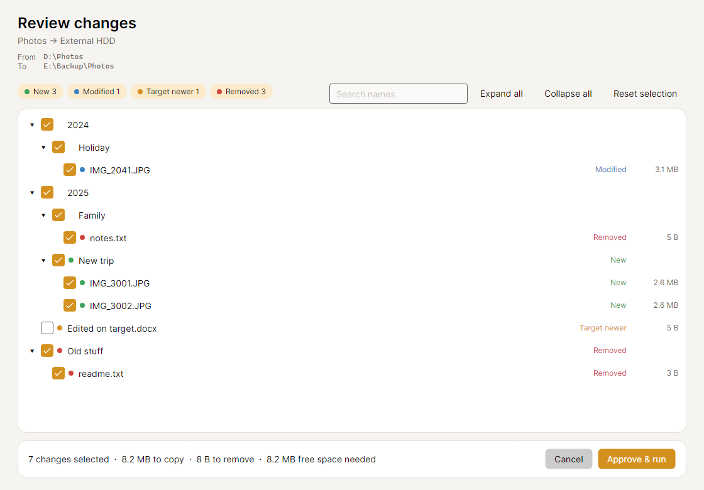
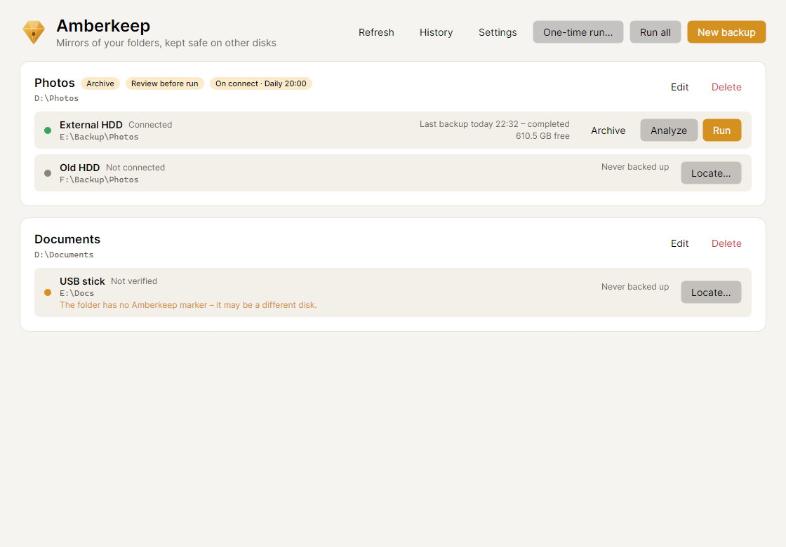
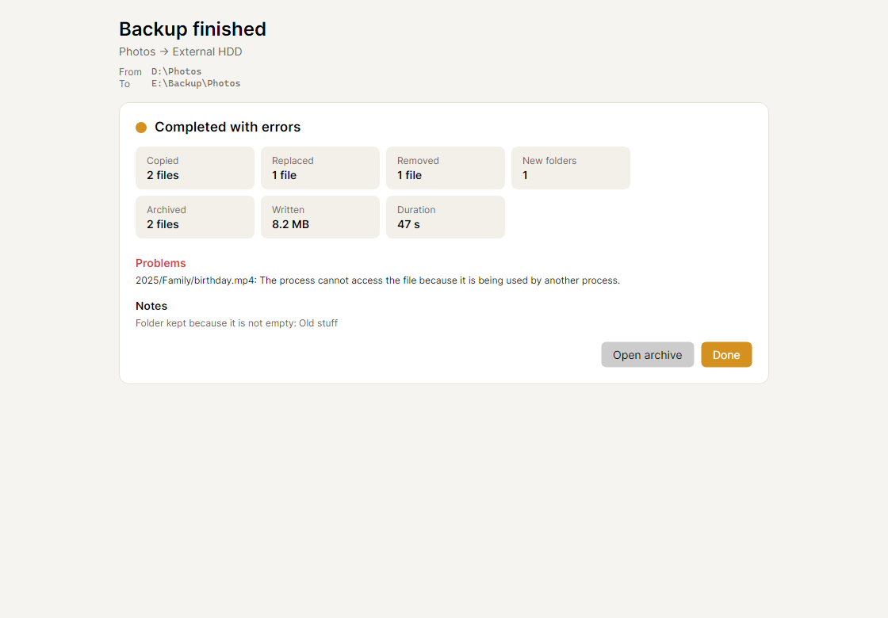
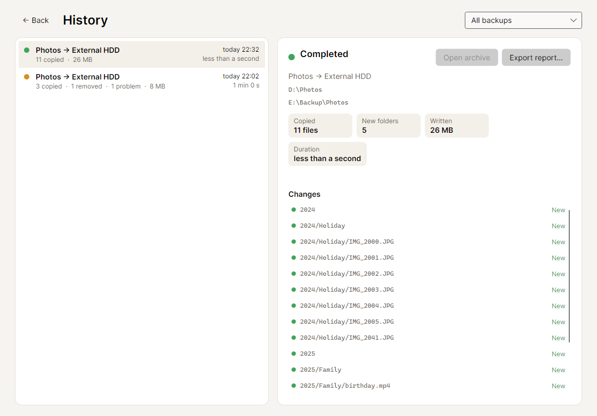
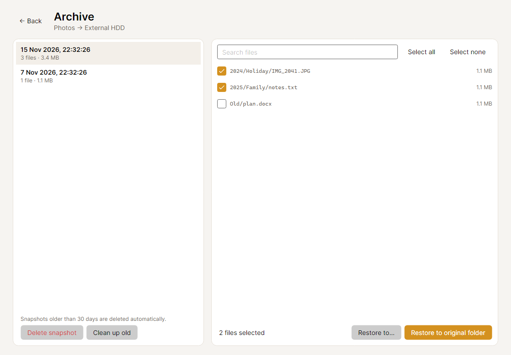

<p align="center">
  
</p>

<h1 align="center">Amberkeep</h1>

<p align="center">
  <b>Folder backups you can see before they happen.</b><br>
  Exact copies of your folders on backup disks – with every change shown to you first.
</p>

<p align="center">
  <a href="../../releases/latest"></a>
</p>

<p align="center">
  <a href="LICENSE"></a>
  
  
  
  
</p>

<p align="center">
  <a href="#features">Features</a> ·
  <a href="#download-and-start">Download</a> ·
  <a href="#quick-start">Quick start</a> ·
  <a href="#building-from-source">Building</a> ·
  <a href="#license">License</a>
</p>

<p align="center">
  <picture>
    <source media="(prefers-color-scheme: dark)" srcset="docs/images/diff-dark.png">
    
  </picture>
</p>

Amberkeep keeps exact copies (mirrors) of the folders you choose on one or more backup disks. Before anything is changed, it shows you every file that would be copied, replaced or removed, and lets you untick what you don't want. Files on the backup disk that are not part of the backup are never touched.

It is a single portable program for Windows: no installer, no database, no background services. Everything it stores lives next to the executable.

<table>
  <tr>
    <td width="33%" valign="top">
      <b>See before it happens</b><br>
      Every run can start with a list of changes. Untick anything you are not sure about.
    </td>
    <td width="33%" valign="top">
      <b>Your source stays untouched</b><br>
      Source folders are only read. On the backup disk Amberkeep writes only the mirror and its own <code>.amberkeep</code> folder.
    </td>
    <td width="33%" valign="top">
      <b>Runs on its own</b><br>
      From the tray, when a backup disk is plugged in or on a schedule. It asks first when something looks wrong.
    </td>
  </tr>
</table>

## Features

- **One-way mirror** of selected folders to any number of targets (external disks, USB sticks, other internal disks).
- **Preview and approval**: a list of changes with checkboxes – new, modified, newer on the target, removed, renamed by case only. Approval before every run can be switched off per backup.
- **Disks recognized by a marker**, not by drive letter. A disk that comes back as `F:` instead of `E:` is still found; a different disk at the same letter is never written to.
- **Safety guards**:
  - stops when the source is missing, empty or unreadable, or when source and target overlap,
  - asks before removing many files (more than 50 % or at least 1,000 files, adjustable),
  - checks free space before starting,
  - copies to a temporary name and renames only when complete, so an interrupted run never leaves half-written files.
- **Optional archive**: replaced and removed files are kept on the target for a number of days, with a browser to restore them.
- **Comparison** by size and modification time (±2 s, with a FAT daylight-saving fix), or byte by byte.
- **Exclusions** with simple gitignore-style patterns (`node_modules/`, `*.tmp`, `/build/`).
- **Runs in the background** from the system tray:
  - automatic runs when a target disk is connected, or on a schedule (daily, chosen weekdays, monthly, every N hours),
  - progress ring in the tray icon and small notifications,
  - optional start with Windows.
- **One-time run**: mirror any folder once without saving anything.
- **History** of every run with export to HTML or text, **export and import** of backup settings to another computer.
- **Clean up everything**: removes the settings, history, autostart entry and (optionally) the markers on your disks. Your backed-up files are never deleted.

## Screenshots

<table>
  <tr>
    <td width="50%" valign="top">
      <picture>
        <source media="(prefers-color-scheme: dark)" srcset="docs/images/dashboard-dark.png">
        
      </picture>
      <p align="center"><sub>Backups and their disks at a glance</sub></p>
    </td>
    <td width="50%" valign="top">
      <picture>
        <source media="(prefers-color-scheme: dark)" srcset="docs/images/run-result-dark.png">
        
      </picture>
      <p align="center"><sub>What was copied, replaced and removed</sub></p>
    </td>
  </tr>
  <tr>
    <td width="50%" valign="top">
      <picture>
        <source media="(prefers-color-scheme: dark)" srcset="docs/images/history-dark.png">
        
      </picture>
      <p align="center"><sub>History of every run, exportable</sub></p>
    </td>
    <td width="50%" valign="top">
      <picture>
        <source media="(prefers-color-scheme: dark)" srcset="docs/images/archive-dark.png">
        
      </picture>
      <p align="center"><sub>Restore replaced or removed files from the archive</sub></p>
    </td>
  </tr>
</table>

<p align="center"><sub>Light or dark, following the system theme.</sub></p>

## Download and start

1. Download `Amberkeep-<version>-win-x64.zip` from the [releases](../../releases/latest).
2. Unpack it into a folder you can write to, for example `D:\Tools\Amberkeep`. Amberkeep keeps its settings next to the program, so `Program Files` does not work: Windows lets only administrators write there, and Amberkeep would start read-only.
3. Start `Amberkeep.exe`. No .NET or other runtime needs to be installed.

Windows may warn about an unknown publisher (SmartScreen), because the program is not code-signed. Choose **More info → Run anyway**.

Requirements: Windows 10 or 11, 64-bit.

### Where Amberkeep keeps its data

```
Amberkeep.exe, *.dll, LICENSE …   the program
amberkeep.json                    your backups and settings (plain JSON, can be copied)
history/                          one record per run
```

On each target disk Amberkeep writes only into a `.amberkeep/` folder (the marker, temporary files during a run and the optional archive). The source folders are only ever read. Outside its own folder Amberkeep writes nothing, except the autostart entry if you switch on *Start with the system*.

To move Amberkeep, move the whole folder. To remove it, use **Settings → Clean up everything** and delete the folder.

## Quick start

1. **New backup** → choose the source folder.
2. **Add target…** → choose a folder on the backup disk (for example `E:\Backup\Photos`).
3. **Save**, then **Analyze** → review the list of changes → **Run**.

The first run copies everything. Later runs copy only what changed.

## Building from source

Requires the [.NET 10 SDK](https://dotnet.microsoft.com/download).

```bash
dotnet build
dotnet test
dotnet run --project src/Amberkeep.App
```

Release build (portable zip in `artifacts/`):

```bash
powershell -File build/publish.ps1
```

The tests include UI tests that drive the real window with simulated mouse clicks (headless). Checks that open windows on the desktop (Explorer for *Show in folder*) run only on request, e.g. before a release:

```powershell
$env:AMBERKEEP_DESKTOP_TESTS = "1"; dotnet test
```

README images (screenshots with sample data, and the logo):

```bash
dotnet run --project tools/Amberkeep.Screenshots -- --readme
dotnet run --project tools/Amberkeep.IconGen
```

Project layout:

```
src/Amberkeep.Core      scan, diff, execution, safety checks (no UI)
src/Amberkeep.Storage   amberkeep.json, history, target markers
src/Amberkeep.App       Avalonia UI, tray, notifications, scheduler
tests/Amberkeep.Tests   xUnit tests (temporary folders only)
tools/                  developer tools: diff printer, screenshots, icon generator
docs/images/            README images (from the Screenshots and IconGen tools)
```

[`SPEC.md`](SPEC.md) describes the behavior in detail.

The code is cross-platform (.NET + Avalonia), but only the Windows build is packaged and tested so far. Linux and macOS builds are planned.

What changed in each version: [`CHANGELOG.md`](CHANGELOG.md).

## License

Copyright © 2026 LAMINATKAR.

Amberkeep is free software under the [GNU General Public License v3](LICENSE). It comes with no warranty.

It includes open-source components under their own licenses (MIT, BSD, SIL OFL); see [`THIRD-PARTY-NOTICES.txt`](THIRD-PARTY-NOTICES.txt).
